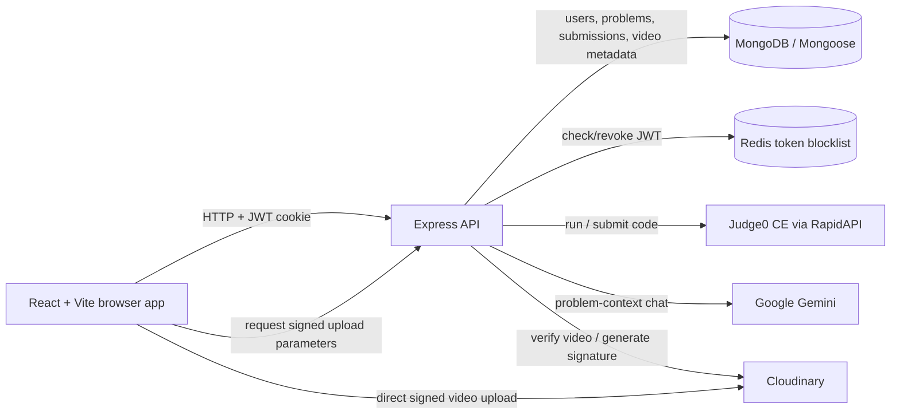

# CodeGurukul

**An AI-powered coding practice and learning platform for solving data-structure and algorithm problems.**

[](https://react.dev/)
[](https://nodejs.org/)
[](https://www.mongodb.com/)

## Overview

CodeGurukul brings coding practice, code execution, and problem-focused AI tutoring into one web application. Learners can browse and filter problems, write solutions in an in-browser editor, run examples, submit against hidden test cases, and review submission history. An AI chat uses the active problem as context to answer DSA-related questions. Admin users can manage problem content and attach video solutions.

The repository contains a React frontend and an Express API. The API persists users, problems, and submissions in MongoDB, uses Redis to block logged-out JWTs, and integrates with Google Gemini, Judge0, and Cloudinary for optional AI, code execution, and video workflows.

## Features

- **Authentication and roles:** registration and login with bcrypt-hashed passwords, JWT cookies, and user/admin middleware.
- **Problem practice:** browse problems by difficulty and tag, view descriptions and visible examples, and see saved submissions.
- **In-browser coding:** edit JavaScript, Java, and C++ with Monaco Editor.
- **Code execution:** run code against visible cases and submit it against hidden cases through Judge0.
- **Submission records:** persist code, language, status, test-case counts, runtime, memory, and timestamps in MongoDB.
- **AI DSA chat:** ask problem-specific questions through Google Gemini (`gemini-2.5-flash`).
- **Admin problem management:** create, update, and delete coding problems; problem creation checks reference solutions against visible cases.
- **Video solutions:** create signed Cloudinary uploads, save video metadata, and play attached videos on the problem page.
- **Redis token revocation:** add logged-out tokens to a Redis blocklist until their JWT expiration. Redis is not used as a general session store or cache.

## Tech Stack

| Area | Technologies |
| --- | --- |
| Frontend | React 19, Vite, React Router, Redux Toolkit, Axios, Monaco Editor |
| UI and forms | Tailwind CSS 4, DaisyUI, React Hook Form, Zod, Lucide React |
| Backend | Node.js, Express 5 |
| Database | MongoDB with Mongoose |
| Token revocation | Redis (`redis` Node.js client) |
| Authentication | JSON Web Tokens, bcrypt, cookie-parser |
| AI | Google GenAI SDK; Gemini `gemini-2.5-flash` |
| Code execution | Judge0 CE through the RapidAPI endpoint |
| Video storage | Cloudinary |

## Architecture

The frontend sends credentialed HTTP requests to the Express API. The API checks JWT cookies and role middleware where required, reads or writes MongoDB documents, and uses Redis to reject revoked tokens. Code requests are sent to Judge0; AI chat requests go to Gemini. For video uploads, the API signs upload parameters, the browser uploads directly to Cloudinary, and the API verifies and stores the resulting metadata.



## Project Structure

```text
.
├── Backend/
│   ├── .gitignore
│   ├── package.json
│   ├── package-lock.json
│   └── src/
│       ├── index.js
│       ├── config/
│       │   ├── database.js
│       │   └── redis.js
│       ├── controllers/
│       │   ├── solveDoubt.js
│       │   ├── userAuthent.js
│       │   ├── userProblem.js
│       │   ├── userSubmission.js
│       │   └── videoSection.js
│       ├── middleware/
│       │   ├── adminMiddleware.js
│       │   └── userMiddleware.js
│       ├── models/
│       │   ├── problem.js
│       │   ├── solutionVideo.js
│       │   ├── submission.js
│       │   └── user.js
│       ├── routes/
│       │   ├── aiChatting.js
│       │   ├── problemCreator.js
│       │   ├── submit.js
│       │   ├── userAuth.js
│       │   └── videoCreator.js
│       └── utils/
│           ├── problemUtility.js
│           └── validator.js
└── Frontend/
    ├── .gitignore
    ├── package.json
    ├── package-lock.json
    ├── README.md
    ├── eslint.config.js
    ├── index.html
    ├── vite.config.js
    ├── public/
    │   └── vite.svg
    └── src/
        ├── App.jsx
        ├── App.css
        ├── authSlice.js
        ├── index.css
        ├── main.jsx
        ├── assets/
        │   └── react.svg
        ├── store/
        │   └── store.js
        ├── utils/
        │   └── axiosClient.js
        ├── pages/
        │   ├── Admin.jsx
        │   ├── Homepage.jsx
        │   ├── Login.jsx
        │   ├── ProblemPage.jsx
        │   └── Signup.jsx
        └── components/
            ├── AdminDelete.jsx
            ├── AdminPanel.jsx
            ├── AdminUpdate.jsx
            ├── AdminUpload.jsx
            ├── AdminVideo.jsx
            ├── ChatAi.jsx
            ├── Editorial.jsx
            └── SubmissionHistory.jsx
```

The local `Backend/.env` file is intentionally not listed. Dependency directories and build artifacts are not part of the source layout.

## Getting Started

### Prerequisites

- Node.js and npm.
- A MongoDB database and connection string.
- Access to the Redis endpoint configured in `Backend/src/config/redis.js`.
- Google Gemini credentials for the AI chat feature.
- Cloudinary credentials for video upload and deletion.
- A working Judge0 RapidAPI credential for code execution.

The application is configured for local development: the frontend API client targets `http://localhost:4000`, and backend CORS allows `http://localhost:5173` and `http://127.0.0.1:5173`.

### Clone and install

```bash
git clone https://github.com/Vicky7632/CodeGurukul-With-Ai.git
cd CodeGurukul-With-Ai

cd Backend
npm ci

cd ../Frontend
npm ci
```

### Configure the backend

Create `Backend/.env` with the variables below. The values shown are placeholders; use your own credentials and do not commit the file.

```dotenv
PORT=4000
DB_CONNECTION_STRING=mongodb://127.0.0.1:27017/codegurukul
JWT_KEY=replace_with_a_long_random_secret
REDIS_PASS=replace_with_redis_password
GEMINI_KEY=replace_with_gemini_api_key

# Needed for video upload and management
CLOUDINARY_CLOUD_NAME=your_cloud_name
CLOUDINARY_API_KEY=your_cloudinary_api_key
CLOUDINARY_API_SECRET=your_cloudinary_api_secret
```

`PORT`, `DB_CONNECTION_STRING`, `JWT_KEY`, and `REDIS_PASS` are used by the server's core startup or authentication flows. `GEMINI_KEY` is needed for AI chat. The Cloudinary values are needed for video operations.

**Redis configuration note:** Redis host and port are hard-coded in `Backend/src/config/redis.js`; only the password is read from the environment. A local Redis server will not be used by the current configuration unless its host/port are changed in the application. The server connects to MongoDB and Redis before it begins listening.

**Judge0 credential note:** Judge0 is configured in `Backend/src/utils/problemUtility.js` to use a RapidAPI endpoint. Its API credential is currently embedded in source rather than read from an environment variable. Obtain and configure your own credential securely before relying on code execution; do not publish credentials in source control. No Judge0 environment variable is currently implemented.

### Run locally

Start the backend in one terminal:

```bash
cd Backend
node src/index.js
```

Start the frontend in another terminal:

```bash
cd Frontend
npm run dev
```

Open the Vite URL printed in the terminal (normally `http://localhost:5173`). The API listens on the `PORT` value in `Backend/.env`; use `4000` to match the frontend's configured API base URL.

The backend package does not define `start` or `dev` scripts. The available frontend scripts are:

| Command (from `Frontend/`) | Purpose |
| --- | --- |
| `npm run dev` | Start the Vite development server |
| `npm run build` | Build the frontend |
| `npm run preview` | Preview a built frontend |
| `npm run lint` | Run ESLint |

There is no configured backend test suite: its `test` script exits with “Error: no test specified”. The frontend package does not define a test script either.

## API Documentation

All endpoints are mounted on the backend origin (for example, `http://localhost:4000`). Protected routes use the `token` cookie issued at login; the frontend Axios client sends credentials. User routes require a valid user session; admin routes additionally require an admin role.

### Authentication

| Method | Endpoint | Access | Purpose |
| --- | --- | --- | --- |
| `POST` | `/user/register` | Public | Create a standard user and issue a login cookie |
| `POST` | `/user/login` | Public | Authenticate and issue a login cookie |
| `POST` | `/user/logout` | User | Revoke the current token in Redis and clear its cookie |
| `GET` | `/user/check` | User | Validate the cookie and return the current user |
| `POST` | `/user/admin/register` | Admin | Create an account using the supplied role |
| `DELETE` | `/user/deleteProfile` | Admin | Delete the authenticated admin account |

Registration and login accept JSON. Example registration body:

```json
{
  "firstName": "Alex",
  "emailId": "alex@example.com",
  "password": "replace-with-a-strong-password"
}
```

The backend requires a valid email and a strong password for registration. Admin registration is not public; an existing admin session is required.

### Problems and submissions

| Method | Endpoint | Access | Purpose |
| --- | --- | --- | --- |
| `POST` | `/problem/create` | Admin | Create a problem; reference solutions are checked against visible test cases |
| `PUT` | `/problem/update/:id` | Admin | Update a problem |
| `DELETE` | `/problem/delete/:id` | Admin | Delete a problem |
| `GET` | `/problem/getAllProblem` | User | List problem IDs, titles, difficulty, and tags |
| `GET` | `/problem/problemById/:id` | User | Fetch problem details and an attached video, if present |
| `GET` | `/problem/problemSolvedByUser` | User | List problems associated with the current user as solved |
| `GET` | `/problem/submittedProblem/:pid` | User | Fetch the current user's submissions for a problem |
| `POST` | `/submission/run/:id` | User | Run code against visible test cases |
| `POST` | `/submission/submit/:id` | User | Evaluate code against hidden test cases and persist a submission |

Run and submit requests accept:

```json
{
  "code": "function solution() { return 42; }",
  "language": "javascript"
}
```

The accepted language values are `javascript`, `java`, and `cpp` (the backend also maps `js` and `c++`). The `:id` parameter is the problem ID. Run returns Judge0's per-test-case results; submit returns the saved submission record.

### AI chat

| Method | Endpoint | Access | Purpose |
| --- | --- | --- | --- |
| `POST` | `/ai/chat` | User | Send problem-context messages to Gemini |

The request body includes `messages`, `title`, `description`, `testCases`, and `startCode`. Messages use Gemini-style `{ "role": "...", "parts": [{ "text": "..." }] }` objects. A successful response contains a `message` string.

### Video solutions

| Method | Endpoint | Access | Purpose |
| --- | --- | --- | --- |
| `GET` | `/video/create/:problemId` | Admin | Generate Cloudinary signed-upload parameters |
| `POST` | `/video/save` | Admin | Verify a Cloudinary resource and save its metadata |
| `DELETE` | `/video/delete/:problemId` | Admin | Delete the stored video and its Cloudinary resource |

The frontend uploads the video directly to Cloudinary using the signed parameters, then posts `problemId`, `cloudinaryPublicId`, `secureUrl`, and `duration` to `/video/save`.

## Authentication and Authorization

Registration hashes passwords with bcrypt. Login signs a JWT containing the user ID, email, and role, with a one-hour expiration, and sends it in a `token` cookie. The frontend uses credentialed requests and calls `/user/check` during app initialization to restore its authentication state.

`userMiddleware` verifies the JWT, looks up the account, and checks the Redis blocklist. `adminMiddleware` performs those checks and requires the role in the verified token to be `admin`. Logout puts the token in Redis until its JWT expiration and clears the cookie.

Admin creation is protected by the admin middleware; there is no public admin signup endpoint. Admin authorization is enforced by both frontend route checks and backend middleware, with the backend providing the API boundary.

## Code Execution Workflow

1. The problem page sends the selected language and editor contents to the authenticated API.
2. The backend loads the problem and maps the language name to a Judge0 language ID.
3. **Run** sends the visible test cases to Judge0. **Submit** sends the hidden test cases.
4. The backend submits a batch, polls the returned Judge0 tokens, and reads the execution results.
5. For a submission, the backend records the code, language, status, passed/total test cases, runtime, memory, and error message in MongoDB.

Judge0 is called through the RapidAPI-hosted Judge0 CE endpoint configured in `Backend/src/utils/problemUtility.js`. Polling currently repeats at a fixed interval without an application-level timeout.

**Progress-tracking caveat:** the current submission handler adds the problem to the user's `problemSolved` list after processing a submission, without requiring an `accepted` status. The solved-problem filter should therefore not be treated as proof that every listed problem passed all hidden test cases.

## AI Integration

The authenticated `/ai/chat` endpoint uses the Google GenAI SDK and the `gemini-2.5-flash` model. It passes the problem title, description, visible test cases, starter code, and cleaned chat messages to Gemini with a system instruction focused on DSA tutoring, hints, code review, solutions, and complexity analysis. The API returns the generated text as `message`.

The key is read from `GEMINI_KEY`. Gemini availability and usage are subject to the configured Google API account and its limits.

## Security Considerations

### Implemented

- Password hashes are created with bcrypt.
- JWTs expire after one hour and are verified by protected API middleware.
- Redis token revocation is checked on protected requests and used on logout.
- Admin-only API operations use role-checking middleware.
- Registration validates email format and password strength.
- Cloudinary uploads use a server-generated signature.

### Hardening still recommended

- **Rotate and remove the Judge0 credential embedded in `Backend/src/utils/problemUtility.js`.** It is present in tracked application source; treat it as exposed. Store a replacement in an environment variable and ensure it is never committed.
- Configure Redis host and port through environment variables instead of relying on the fixed endpoint.
- Set cookie security attributes (`httpOnly`, `secure` in HTTPS deployments, and an appropriate `sameSite` policy); the current cookie calls do not explicitly set them.
- Add request rate limits and CSRF protections for cookie-authenticated routes.
- Make CORS origins and the frontend API URL configurable for deployment; current values are local-development URLs.
- Add bounded Judge0 polling, robust error handling, and input/resource limits for code requests.

These recommendations are not claims about protections already present in the code.

## Screenshots and Demo

No screenshots or live demo URL are included in the repository. Add application screenshots here when available.

## Future Improvements

- Move all external service endpoints and credentials to validated environment configuration.
- Add automated backend tests for authentication, role checks, problem management, and execution result handling.
- Improve Judge0 polling with timeouts, retry/backoff policy, and explicit provider error states.
- Mark a problem as solved only after an accepted submission.
- Add pagination and richer search/filter support for problems and submissions.
- Add deployment-specific CORS, API URL, and secure cookie configuration.
- Add screenshots or a hosted demo when available.

## Contributing

Contributions are welcome. Before opening a pull request:

1. Open an issue or describe the intended change in the pull request.
2. Keep changes focused and avoid committing `.env` files, API keys, or other credentials.
3. Install dependencies using `npm ci` in the relevant package directory.
4. For frontend changes, run `npm run lint` and `npm run build` from `Frontend/`.
5. Include manual verification steps for backend changes; a backend automated test suite is not currently configured.

## License

`Backend/package.json` declares the ISC license, but the repository does not include a root-level `LICENSE` file. The licensing terms for the complete repository should be clarified by adding an explicit license file.

## Author

**Vicky Kumar** — [GitHub](https://github.com/Vicky7632)
